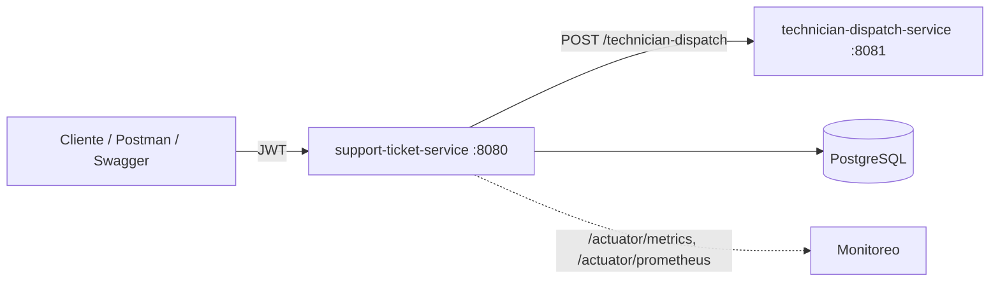
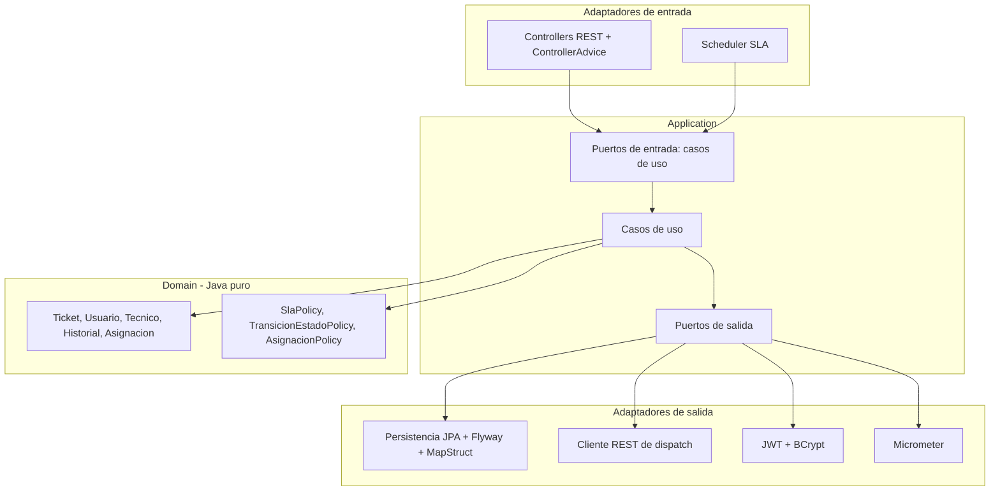
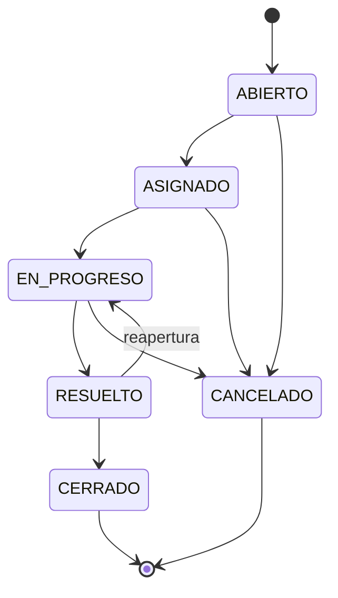

# HelpFlow – Sistema Integral de Gestión de Soporte TI

Prueba de desempeño del Módulo 6 (RIWI). Sistema de tickets de soporte para una empresa con equipos en varias sedes: registrar, priorizar, asignar, escalar y cerrar tickets con trazabilidad, seguridad JWT y observabilidad.

**Autor:** Guillermo De Leon Rojano

## Arquitectura

Monorepo con dos microservicios en Java 21 y Maven:

| Servicio | Spring Boot | Puerto | Descripción |
|---|---|---|---|
| `support-ticket-service` | 4.1.2 | 8080 | Servicio central de tickets. Arquitectura hexagonal, JPA/Hibernate, JWT, Flyway, Actuator/Micrometer |
| `technician-dispatch-service` | 3.5.6 | 8081 | Servicio simulado y liviano (sin JPA ni seguridad) que sugiere un técnico y un tiempo estimado de forma determinista |

### Relación entre microservicios



Si el dispatch-service no responde (timeout o error 5xx), el ticket se crea igualmente en estado `ABIERTO` sin asignar y queda registrada la observación en su historial.

### Arquitectura hexagonal de `support-ticket-service`



Reglas aplicadas y verificadas con pruebas y `grep`:

- `domain` es Java puro: sin Spring, Jakarta, Jackson, Lombok ni MapStruct.
- `application` solo usa `@Service` y `@Transactional` de Spring; no importa web, security, data, JPA ni Micrometer.
- La paginación usa tipos propios (`PaginaSolicitud`, `PaginaResultado`, `FiltroTickets`); `Page` de Spring solo existe en el adaptador JPA.

### Ciclo de vida del ticket



`RESUELTO` y `CANCELADO` exigen una observación. `CERRADO` y `CANCELADO` son estados finales.

## Flujo de asignación

1. El usuario registra un ticket en estado `ABIERTO`.
2. El sistema calcula la fecha límite de SLA según la prioridad.
3. Consulta a `technician-dispatch-service` por un técnico sugerido, su disponibilidad y el tiempo estimado.
4. Aplica las reglas internas de asignación: técnico activo, compatibilidad entre categoría y especialidad, carga máxima de tickets activos, preferencia por la misma sede, y prioridad para tickets críticos o próximos a vencer. Si el técnico sugerido no cumple, elige el mejor alternativo.
5. Genera la asignación y registra el historial. **Todo ocurre en una sola transacción** (`@Transactional`); si algo falla, se revierte el ticket, la asignación y el historial.

### Reglas de SLA

| Prioridad | Plazo de atención |
|---|---|
| CRITICA | 4 horas |
| ALTA | 8 horas |
| MEDIA | 24 horas |
| BAJA | 72 horas |

Los plazos son configurables por el administrador (`/admin/sla`). Los tickets activos próximos a incumplir el SLA se escalan: suben un nivel de prioridad y se registra el historial.

## Roles y seguridad

- Autenticación stateless con **JWT** (HS256), contraseñas con **BCrypt** (`PasswordEncoder`).
- `ROLE_USUARIO`: crea y consulta únicamente sus tickets.
- `ROLE_TECNICO`: consulta y gestiona los tickets que tiene asignados. Se registra indicando un código de técnico existente cuyo documento coincida.
- `ROLE_ADMIN`: acceso completo, reasignación y configuración de SLA. No se puede registrar por la API: se crea al arrancar solo si están definidas `ADMIN_EMAIL`, `ADMIN_PASSWORD` y `ADMIN_DOCUMENTO`.
- Los errores 401 y 403 se devuelven como `application/problem+json` y alimentan las métricas.

## Endpoints

### support-ticket-service (`:8080`)

| Método | Ruta | Rol | Descripción |
|---|---|---|---|
| POST | `/auth/register` | público | Registro de usuario o técnico |
| POST | `/auth/login` | público | Devuelve el JWT |
| POST | `/tickets` | USUARIO | Crea un ticket (201 con `Location`) |
| GET | `/tickets` | autenticado | Lista paginada con `page`, `size`, `sort`, `dir`, `estado`, `categoria`, `prioridad`; cada rol ve lo suyo |
| GET | `/tickets/{id}` | autenticado | Detalle con historial |
| PATCH | `/tickets/{id}/estado` | USUARIO (cancelar el propio), TECNICO asignado, ADMIN | Transición de estado con observación |
| POST | `/tickets/{id}/observaciones` | solicitante, TECNICO asignado, ADMIN | Registra una observación sin cambiar el estado |
| PUT | `/tickets/{id}/asignacion` | ADMIN | Reasigna a otro técnico |
| POST | `/admin/tickets/escalar` | ADMIN | Dispara el escalamiento y devuelve cuántos tickets escaló |
| GET / PUT | `/admin/sla` | ADMIN | Consulta y configura los plazos de SLA |
| GET | `/actuator/health`, `/actuator/info` | público | Salud e información |
| GET | `/actuator/metrics`, `/actuator/prometheus` | ADMIN | Métricas |
| GET | `/swagger-ui.html` | público | Documentación Swagger / OpenAPI |

### technician-dispatch-service (`:8081`)

`POST /technician-dispatch`

```json
{ "ticketId": 125, "categoria": "RED", "prioridad": "ALTA" }
```

Respuesta (determinista: la misma combinación siempre devuelve lo mismo):

```json
{ "ticketId": 125, "tecnicoId": "TEC-002", "disponibilidad": "BAJA", "tiempoEstimadoHoras": 11 }
```

Disponibilidad: 0–2 h → `ALTA`, 3–8 h → `MEDIA`, más de 8 h → `BAJA`.

## Errores estándar (RFC 7807)

Todas las respuestas de error usan `ProblemDetail` con `type`, `title`, `status`, `detail`, `instance`, `timestamp` y `traceId`. El `traceId` se toma del header `X-Trace-Id` si llega, o se genera, y aparece también en los logs.

## Persistencia

- JPA + Hibernate con relaciones Usuario 1–N Tickets, Ticket 1–N Historial y Ticket N–1 Técnico asignado, todas en `LAZY`.
- Anti N+1: `@EntityGraph` para las relaciones a uno, `default_batch_fetch_size` para colecciones, y sin `join fetch` de colecciones junto con paginación.
- Flyway: `V1__schema`, `V2__asignaciones_historial_sla`, `V3__datos_iniciales` (técnicos TEC-001 a TEC-050). `ddl-auto: validate` y `open-in-view: false`.

## Observabilidad

- Actuator expone `health`, `info`, `metrics` y `prometheus`.
- Métricas de negocio con Micrometer: tickets creados por categoría y prioridad, tickets vencidos según SLA, tiempo de primera respuesta y de resolución, fallas de autenticación y accesos denegados. Consúltalas en `/actuator/metrics`.
- Logging estructurado en JSON (formato ECS) con el perfil `docker`; en local, texto con `traceId`.

## Cómo ejecutar

### Con Docker Compose

```bash
cp .env.example .env      # edita los valores (JWT_SECRET de al menos 32 caracteres)
docker compose up --build
```

Servicios: `support-ticket-service` en http://localhost:8080, `technician-dispatch-service` en http://localhost:8081 y PostgreSQL en el puerto 5433 del host. Swagger: http://localhost:8080/swagger-ui.html

### En local (sin Docker para las apps)

```bash
docker compose up -d db
./mvnw -f technician-dispatch-service/pom.xml spring-boot:run
DB_URL=jdbc:postgresql://localhost:5433/helpflow DB_USER=helpflow DB_PASSWORD=helpflow_dev \
JWT_SECRET=un-secreto-de-desarrollo-de-al-menos-32-caracteres \
./mvnw -f support-ticket-service/pom.xml spring-boot:run
```

### Pruebas

```bash
./mvnw -f technician-dispatch-service/pom.xml test
./mvnw -f support-ticket-service/pom.xml test     # requiere Docker (Testcontainers)
```

Pruebas unitarias (JUnit + Mockito, con `TechnicianDispatchPort` mockeado), de integración (Spring Boot Test + MockMvc) y de persistencia con **Testcontainers** sobre PostgreSQL real.

## Evidencias

Capturas en `docs/evidencias/`:

- [ ] Resultado de los tests (`BUILD SUCCESS`)
- [ ] `docker compose up` con los tres servicios arriba
- [ ] Swagger UI
- [ ] Registro, login y creación de un ticket asignado
- [ ] Error `ProblemDetail` con `traceId`
- [ ] `/actuator/metrics` y `/actuator/prometheus` con métricas de negocio
- [ ] Tickets vencidos / escalados por SLA
- [ ] Logs estructurados

## Estructura del repositorio

```text
.
├── docker-compose.yml
├── .env.example
├── docs/                      # contexto, diagramas y evidencias
├── postman/                   # colección de pruebas
├── support-ticket-service/    # domain · application · infrastructure
└── technician-dispatch-service/
```

## Guía de uso: Swagger y Postman

Con la aplicación en marcha (`docker compose up --build`), la API queda en `http://localhost:8080`.

### Swagger UI

1. Abre http://localhost:8080/swagger-ui.html (contrato en http://localhost:8080/v3/api-docs).
2. Ejecuta `POST /auth/register` con:
   ```json
   {"documento":"1001","nombre":"Ana Perez","correoCorporativo":"ana@helpflow.com","sede":"BARRANQUILLA","area":"TI","password":"Ana12345!"}
   ```
3. Ejecuta `POST /auth/login` con `{"correoCorporativo":"ana@helpflow.com","password":"Ana12345!"}` y copia el valor de `token`.
4. Pulsa **Authorize** (candado), pega el token y confirma.
5. Ejecuta `POST /tickets`:
   ```json
   {"titulo":"No hay internet en sala 3","descripcion":"Sin conexion desde la manana","categoria":"RED","prioridad":"ALTA","sede":"BARRANQUILLA","activoAfectado":"Switch piso 3"}
   ```
   El ticket queda `ASIGNADO` con un `tecnicoAsignadoCodigo`, porque el servicio consulta a `technician-dispatch-service`.
6. Consulta `GET /tickets` y `GET /tickets/{id}` para ver el ticket con su historial.

### Postman

1. **Import** → **Link** → `http://localhost:8080/v3/api-docs` → formato *Postman Collection*. También puedes importar `postman/HelpFlow.postman_collection.json`.
2. En la colección, pestaña **Authorization**: tipo *Bearer Token* con valor `{{token}}`.
3. En la petición `POST /auth/login`, pestaña **Scripts** (o **Tests**), para guardar el token automáticamente:
   ```javascript
   pm.collectionVariables.set("token", pm.response.json().token);
   ```
4. Ejecuta en orden: registro, login, crear ticket, listar tickets.

### Resultados esperados

| Petición | Resultado |
|---|---|
| `POST /auth/register` | Usuario creado con `rol: ROLE_USUARIO` |
| `POST /auth/login` | `token` JWT |
| `POST /tickets` | `estado: ASIGNADO` con técnico asignado |
| `GET /tickets` sin token | 401 `application/problem+json` con `traceId` |
| `GET /admin/sla` con usuario normal | 403 `problem+json` |
| `GET /admin/sla` con el administrador | 200 con los plazos de SLA |
| `PATCH /tickets/{id}/estado` con transición inválida (por ejemplo `CERRADO` desde `ASIGNADO`) | 409 `problem+json` |
| `PATCH /tickets/{id}/estado` a `RESUELTO` sin observación | 400 con el detalle de validación |

El **administrador** no se registra por la API: se crea al arrancar con las variables `ADMIN_EMAIL`, `ADMIN_PASSWORD` y `ADMIN_DOCUMENTO` del archivo `.env`. Inicia sesión con esas credenciales para probar `/admin/*`.

Para registrar un **técnico**, usa un código sembrado por Flyway (`TEC-001` a `TEC-050`) con el documento que tiene en la base: `docker compose exec db psql -U helpflow -d helpflow -c "select codigo, documento, nombre, sede from tecnicos limit 5;"`. Envía además `"rol":"ROLE_TECNICO"` y `"codigoTecnico":"TEC-002"` en el registro.

### Métricas

Con el token del administrador:
`GET /actuator/metrics` lista las métricas y `GET /actuator/prometheus` las expone en formato Prometheus.

## Limitaciones conocidas

- La edición del perfil de usuarios y técnicos no está implementada.
- El escalamiento automático por SLA corre cada 60 segundos (`helpflow.sla.escalation.*`) y también puede dispararse con `POST /admin/tickets/escalar`.
