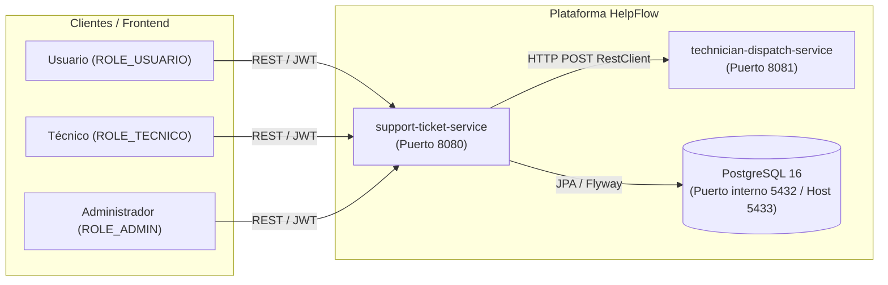

# HelpFlow - Sistema de Gestión de Tickets de Soporte Técnico

> **Prueba de Desempeño - Módulo 6 (RIWI)**  
> Monorepo compuesto por dos microservicios construidos en **Java 21**, **Spring Boot** y bajo los principios estrictos de **Arquitectura Hexagonal (Ports & Adapters)** y **Domain-Driven Design (DDD)**.

---

## 📋 Tabla de Contenidos

1. [Descripción General](#-descripción-general)
2. [Arquitectura del Sistema](#-arquitectura-del-sistema)
   - [Microservicios](#microservicios)
   - [Arquitectura Hexagonal (`support-ticket-service`)](#arquitectura-hexagonal-support-ticket-service)
3. [Stack Tecnológico](#-stack-tecnológico)
4. [Estructura del Proyecto](#-estructura-del-proyecto)
5. [Requisitos Previos](#-requisitos-previos)
6. [Configuración del Entorno (`.env`)](#-configuración-del-entorno-env)
7. [Puesta en Marcha](#-puesta-en-marcha)
   - [Opción 1: Despliegue completo con Docker Compose](#opción-1-despliegue-completo-con-docker-compose-recomendado)
   - [Opción 2: Ejecución local para desarrollo](#opción-2-ejecución-local-para-desarrollo)
8. [Conexión a Base de Datos (DBeaver / DataGrip)](#-conexión-a-base-de-datos-dbeaver--datagrip)
9. [Catálogo de Endpoints de la API](#-catálogo-de-endpoints-de-la-api)
10. [Seguridad y Control de Acceso](#-seguridad-y-control-de-acceso)
11. [Observabilidad y Trazabilidad](#-observabilidad-y-trazabilidad)
12. [Ejecución de Pruebas Automatizadas](#-ejecución-de-pruebas-automatizadas)

---

## 📌 Descripción General

**HelpFlow** es una solución integral para la gestión y resolución ágil de incidencias técnicas en entornos empresariales. El sistema automatiza:

- El registro y categorización de tickets de soporte técnico por parte de los usuarios.
- El despacho y sugerencia inteligente de técnicos especializados mediante comunicación síncrona y resiliente entre microservicios.
- La gestión del ciclo de vida y auditoría del ticket (historial completo de estados y observaciones).
- La configuración y monitoreo del cumplimiento de los **Acuerdos de Nivel de Servicio (SLA)** con escalamiento preventivo.
- Métricas operacionales en tiempo real expuestas hacia sistemas de monitoreo como Prometheus.

---

## 🏗 Arquitectura del Sistema

### Microservicios



1. **`support-ticket-service`** (Spring Boot 4.1.2):  
   Núcleo transaccional de HelpFlow. Implementa la lógica de tickets, autenticación JWT, configuración de SLA, historial y trazabilidad.
2. **`technician-dispatch-service`** (Spring Boot 3.5.6):  
   Microservicio determinista de soporte que analiza la categoría, prioridad y carga laboral para sugerir la asignación óptima de técnicos.
3. **`PostgreSQL 16`**:  
   Base de datos relacional con control de versiones de esquema automatizado mediante **Flyway** (V1 Schema, V2 Asignaciones/Historial/SLA, V3 Datos Iniciales de 50 técnicos).

---

### Arquitectura Hexagonal (`support-ticket-service`)

El servicio principal se estructura respetando rigurosamente las fronteras de aislamiento arquitectónico:

```
src/main/java/com/helpflow/supportticket/
├── domain/                  # NÚCLEO: Java puro. Cero frameworks.
│   ├── model/               # Entidades de dominio (Ticket, Usuario, Tecnico, etc.)
│   ├── service/             # Políticas de negocio (AsignacionPolicy, SlaPolicy, Transiciones)
│   └── exception/           # Excepciones de reglas de negocio
│
├── application/             # APLICACIÓN: Orquestación y casos de uso.
│   ├── port/in/             # Puertos de entrada (interfaces de casos de uso)
│   ├── port/out/            # Puertos de salida (interfaces de persistencia, clientes, métricas)
│   ├── dto/                 # Comandos y DTOs agnósticos
│   └── usecase/             # Servicios de aplicación (@Service, @Transactional)
│
└── infrastructure/          # INFRAESTRUCTURA: Adaptadores tecnológicos.
    ├── adapter/in/rest/     # Controllers REST, DTOs con validación cruzada y Mappers
    ├── adapter/out/client/  # Adaptador HTTP RestClient hacia technician-dispatch-service
    ├── adapter/out/persistence/ # Entidades JPA, Repositorios Spring Data y Mappers
    ├── security/            # Spring Security 7, JWT HS256 (Nimbus), ActorResolver
    ├── observability/       # TraceIdFilter (MDC) y MicrometerMetricasAdapter
    └── config/              # OpenApiConfig (Swagger UI) y configuración de clientes
```

> **Reglas Hexagonales Clave:**
> - `domain`: Nunca importa Spring, Jakarta, Jackson, Lombok ni MapStruct.
> - `application`: Solo utiliza `@Service` y `@Transactional`. Prohibido importar `web`, `security`, `data` o `persistence`.
> - **Paginación desacoplada**: Utiliza DTOs propios (`PaginaSolicitud`, `PaginaResultado`, `PaginaResponse`). Nunca se expone `Page` de Spring fuera del adaptador JPA.

---

## 🛠 Stack Tecnológico

- **Lenguaje:** Java 21 (LTS)
- **Frameworks:** Spring Boot 4.1.2 & Spring Boot 3.5.6
- **Persistencia:** Spring Data JPA, Hibernate 7, Flyway Migration
- **Base de Datos:** PostgreSQL 16
- **Seguridad:** Spring Security 7, OAuth2 Resource Server con Nimbus JWT (HS256)
- **Cliente HTTP:** Spring RestClient (Timeouts de 2s conexión y 3s lectura)
- **Mapeo:** MapStruct 1.6.3
- **Documentación API:** SpringDoc OpenAPI 3.2.0 (Swagger UI)
- **Métricas & Trazabilidad:** Micrometer Prometheus, MDC (Mapped Diagnostic Context)
- **Contenedores:** Docker, Docker Compose
- **Pruebas:** JUnit 5, Mockito, Testcontainers (PostgreSQL), MockRestServiceServer, MockMvc

---

## 📁 Estructura del Monorepo

```text
├── docker-compose.yml              # Orquestación de contenedores (db, dispatch, support)
├── .env.example                    # Plantilla de variables de entorno requeridas
├── mvnw / mvnw.cmd                 # Maven Wrapper unificado
├── docs/                           # Documentación de contexto y diagramas
├── technician-dispatch-service/    # Microservicio de despacho de técnicos
└── support-ticket-service/         # Microservicio principal de tickets
    ├── pom.xml
    └── src/
        ├── main/
        │   ├── java/com/helpflow/supportticket/...
        │   └── resources/
        │       ├── application.yml
        │       └── db/migration/   # Scripts Flyway V1, V2, V3
        └── test/                   # Suite de pruebas unitarias y de integración
```

---

## ⚙️ Requisitos Previos

- **JDK 21** instalado y configurado en el `JAVA_HOME`.
- **Docker** y **Docker Compose** en ejecución.
- Git.

---

## 🔐 Configuración del Entorno (`.env`)

Crea un archivo `.env` en la raíz del proyecto copiando la plantilla:

```bash
cp .env.example .env
```

Configura tus variables en `.env`:

```properties
# Base de datos
DB_PASSWORD=helpflow123

# Secreto JWT (mínimo 32 caracteres / 256 bits)
JWT_SECRET=tu-clave-secreta-de-al-menos-32-caracteres-helpflow-2026

# Administrador inicial creado en el arranque
ADMIN_EMAIL=admin@helpflow.com
ADMIN_PASSWORD=admin123
ADMIN_DOCUMENTO=1000000000
```

---

## 🚀 Puesta en Marcha

### Opción 1: Despliegue completo con Docker Compose (Recomendado)

Construye las imágenes y levanta todos los servicios:

```bash
docker compose up --build -d
```

Verifica el estado de los contenedores:

```bash
docker compose ps
```

| Servicio | URL / Puerto | Descripción |
| :--- | :--- | :--- |
| **`support-ticket-service`** | `http://localhost:8080` | API principal de tickets |
| **`Swagger UI`** | `http://localhost:8080/swagger-ui.html` | Documentación interactiva OpenAPI |
| **`technician-dispatch-service`**| `http://localhost:8081` | Microservicio de despacho |
| **`PostgreSQL`** | `localhost:5433` | Base de datos relacional expuesta al host |

Para detener el ecosistema:

```bash
docker compose down
```

---

### Opción 2: Ejecución local para desarrollo

1. **Levantar únicamente la base de datos en Docker:**
   ```bash
   docker compose up -d db
   ```

2. **Ejecutar `technician-dispatch-service`:**
   ```bash
   ./mvnw -f technician-dispatch-service/pom.xml spring-boot:run
   ```

3. **Ejecutar `support-ticket-service`:**
   ```bash
   DB_URL=jdbc:postgresql://localhost:5433/helpflow \
   DB_USER=helpflow \
   DB_PASSWORD=helpflow123 \
   JWT_SECRET=tu-clave-secreta-de-al-menos-32-caracteres-helpflow-2026 \
   ADMIN_EMAIL=admin@helpflow.com \
   ADMIN_PASSWORD=admin123 \
   ADMIN_DOCUMENTO=1000000000 \
   ./mvnw -f support-ticket-service/pom.xml spring-boot:run
   ```

---

## 🗄 Conexión a Base de Datos (DBeaver / DataGrip)

Para conectarte a la base de datos de desarrollo mediante DBeaver, usa los siguientes parámetros:

- **Manejador:** `PostgreSQL`
- **Host:** `localhost`
- **Puerto:** `5433` *(mapeado hacia el 5432 interno del contenedor)*
- **Database:** `helpflow`
- **Username:** `helpflow`
- **Password:** `helpflow123` *(o el valor fijado en `DB_PASSWORD` en `.env`)*
- **URL JDBC:** `jdbc:postgresql://localhost:5433/helpflow`

---

## 📡 Catálogo de Endpoints de la API

### 1. Autenticación (`/auth`)

| Método | Endpoint | Acceso | Descripción |
| :--- | :--- | :--- | :--- |
| `POST` | `/auth/register` | Público | Registra un nuevo usuario o técnico (`ROLE_USUARIO`, `ROLE_TECNICO`) |
| `POST` | `/auth/login` | Público | Inicia sesión y retorna token JWT con 60 min de validez |

### 2. Gestión de Tickets (`/tickets`)

| Método | Endpoint | Rol Requerido | Descripción |
| :--- | :--- | :--- | :--- |
| `POST` | `/tickets` | `ROLE_USUARIO` | Crea un ticket de soporte. Despacha técnico automáticamente y retorna `201 Created` con encabezado `Location`. |
| `GET` | `/tickets` | `USUARIO`, `TECNICO`, `ADMIN` | Consulta paginada con filtros (`?page=0&size=10&sort=fechaCreacion&dir=desc&estado=&categoria=&prioridad=`). Cada rol visualiza lo que le compete. |
| `GET` | `/tickets/{id}` | `USUARIO`, `TECNICO`, `ADMIN` | Consulta detallada del ticket con validación de pertenencia. |
| `PATCH`| `/tickets/{id}/estado` | `USUARIO`, `TECNICO`, `ADMIN` | Transiciona de estado. **Validación cruzada:** La `observacion` es obligatoria si el estado destino es `RESUELTO` o `CANCELADO`. |
| `POST` | `/tickets/{id}/observaciones`| `USUARIO`, `TECNICO`, `ADMIN` | Agrega una observación al historial del ticket (solo permitido si el ticket no está cerrado/cancelado). |
| `PUT`  | `/tickets/{id}/asignacion` | `ROLE_ADMIN` | Asignación o reasignación manual de técnico. |

### 3. Operaciones Administrativas (`/admin`)

| Método | Endpoint | Rol Requerido | Descripción |
| :--- | :--- | :--- | :--- |
| `POST` | `/admin/tickets/escalar` | `ROLE_ADMIN` | Ejecuta el proceso de escalamiento de tickets próximos a vencer según SLA. |
| `GET`  | `/admin/sla` | `ROLE_ADMIN` | Consulta la configuración actual de plazos SLA en horas. |
| `PUT`  | `/admin/sla` | `ROLE_ADMIN` | Actualiza la matriz de plazos SLA por prioridad (`CRITICA`, `ALTA`, `MEDIA`, `BAJA`). |

### 4. Monitoreo y Diagnóstico (`/actuator`)

| Método | Endpoint | Acceso | Descripción |
| :--- | :--- | :--- | :--- |
| `GET` | `/actuator/health` | Público | Estado de salud de la aplicación |
| `GET` | `/actuator/info` | Público | Información de compilación y versión |
| `GET` | `/actuator/prometheus` | `ROLE_ADMIN` | Métricas de Micrometer en formato Prometheus |

---

## 🔒 Seguridad y Control de Acceso

1. **Tokens JWT Stateless**:
   - Firmados con algoritmo **HS256** mediante Nimbus Jose JWT.
   - Duración: 60 minutos.
   - Contienen `sub` (ID numérico del usuario), `rol` (`ROLE_USUARIO`, `ROLE_TECNICO`, `ROLE_ADMIN`) y `correo`.
2. **Autorización por Actor**:
   - En cada petición, `ActorResolver` extrae la identidad del `Jwt` y construye el objeto de valor de dominio `Actor`.
   - La lógica de acceso fino (ej. un usuario solo puede ver sus propios tickets o cancelar tickets abiertos) es evaluada en los casos de uso, no en la capa web.
3. **Primer Administrador**:
   - `AdminBootstrap` crea el primer usuario con rol `ROLE_ADMIN` en el arranque a partir de `ADMIN_EMAIL`, `ADMIN_PASSWORD` y `ADMIN_DOCUMENTO`.

---

## 🔍 Observabilidad y Trazabilidad

- **`TraceIdFilter`**:
  - Filtro servlet con prioridad máxima (`Ordered.HIGHEST_PRECEDENCE`).
  - Extrae el identificador del header `X-Trace-Id` o genera un UUID versión 4.
  - Almacena el `traceId` en el **MDC** de SLF4J, permitiendo logs contextualizados.
  - Añade la cabecera `X-Trace-Id` en la respuesta HTTP y limpia el MDC al finalizar la petición.
- **Formato RFC 7807 (`ProblemDetail`)**:
  - Todas las respuestas de error siguen el estándar RFC 7807 incluyendo `type`, `title`, `status`, `detail`, `instance`, `timestamp` y el `traceId` correlacionado.

---

## 🧪 Ejecución de Pruebas Automatizadas

La suite de pruebas incluye tests unitarios de dominio y casos de uso, tests de validación cruzada, tests de adaptadores REST con `MockRestServiceServer` y tests de integración con base de datos real mediante **Testcontainers**:

```bash
# Ejecutar todas las pruebas del microservicio principal
./mvnw -f support-ticket-service/pom.xml test
```

Verificación de la pureza de las capas internas:

```bash
# Comprobar que domain y application no tienen dependencias web/http de Spring
grep -rn "org\.springframework\.web" support-ticket-service/src/main/java/com/helpflow/supportticket/domain support-ticket-service/src/main/java/com/helpflow/supportticket/application
grep -rn "org\.springframework\.http" support-ticket-service/src/main/java/com/helpflow/supportticket/domain support-ticket-service/src/main/java/com/helpflow/supportticket/application
```
*(Ambos comandos deben finalizar sin ninguna coincidencia)*.

> **Prueba de Desempeño - Módulo 6 (RIWI)**  
> Monorepo compuesto por dos microservicios construidos en **Java 21**, **Spring Boot** y bajo los principios estrictos de **Arquitectura Hexagonal (Ports & Adapters)** y **Domain-Driven Design (DDD)**.

---

## 📋 Tabla de Contenidos

1. [Descripción General](#-descripción-general)
2. [Arquitectura del Sistema](#-arquitectura-del-sistema)
   - [Microservicios](#microservicios)
   - [Arquitectura Hexagonal (`support-ticket-service`)](#arquitectura-hexagonal-support-ticket-service)
3. [Stack Tecnológico](#-stack-tecnológico)
4. [Estructura del Proyecto](#-estructura-del-proyecto)
5. [Requisitos Previos](#-requisitos-previos)
6. [Configuración del Entorno (`.env`)](#-configuración-del-entorno-env)
7. [Puesta en Marcha](#-puesta-en-marcha)
   - [Opción 1: Despliegue completo con Docker Compose](#opción-1-despliegue-completo-con-docker-compose-recomendado)
   - [Opción 2: Ejecución local para desarrollo](#opción-2-ejecución-local-para-desarrollo)
8. [Conexión a Base de Datos (DBeaver / DataGrip)](#-conexión-a-base-de-datos-dbeaver--datagrip)
9. [Catálogo de Endpoints de la API](#-catálogo-de-endpoints-de-la-api)
10. [Seguridad y Control de Acceso](#-seguridad-y-control-de-acceso)
11. [Observabilidad y Trazabilidad](#-observabilidad-y-trazabilidad)
12. [Ejecución de Pruebas Automatizadas](#-ejecución-de-pruebas-automatizadas)

---

## 📌 Descripción General

**HelpFlow** es una solución integral para la gestión y resolución ágil de incidencias técnicas en entornos empresariales. El sistema automatiza:

- El registro y categorización de tickets de soporte técnico por parte de los usuarios.
- El despacho y sugerencia inteligente de técnicos especializados mediante comunicación síncrona y resiliente entre microservicios.
- La gestión del ciclo de vida y auditoría del ticket (historial completo de estados y observaciones).
- La configuración y monitoreo del cumplimiento de los **Acuerdos de Nivel de Servicio (SLA)** con escalamiento preventivo.
- Métricas operacionales en tiempo real expuestas hacia sistemas de monitoreo como Prometheus.

---

## 🏗 Arquitectura del Sistema

### Microservicios


1. **`support-ticket-service`** (Spring Boot 4.1.2):  
   Núcleo transaccional de HelpFlow. Implementa la lógica de tickets, autenticación JWT, configuración de SLA, historial y trazabilidad.
2. **`technician-dispatch-service`** (Spring Boot 3.5.6):  
   Microservicio determinista de soporte que analiza la categoría, prioridad y carga laboral para sugerir la asignación óptima de técnicos.
3. **`PostgreSQL 16`**:  
   Base de datos relacional con control de versiones de esquema automatizado mediante **Flyway** (V1 Schema, V2 Asignaciones/Historial/SLA, V3 Datos Iniciales de 50 técnicos).

---

### Arquitectura Hexagonal (`support-ticket-service`)

El servicio principal se estructura respetando rigurosamente las fronteras de aislamiento arquitectónico:

```
src/main/java/com/helpflow/supportticket/
├── domain/                  # NÚCLEO: Java puro. Cero frameworks.
│   ├── model/               # Entidades de dominio (Ticket, Usuario, Tecnico, etc.)
│   ├── service/             # Políticas de negocio (AsignacionPolicy, SlaPolicy, Transiciones)
│   └── exception/           # Excepciones de reglas de negocio
│
├── application/             # APLICACIÓN: Orquestación y casos de uso.
│   ├── port/in/             # Puertos de entrada (interfaces de casos de uso)
│   ├── port/out/            # Puertos de salida (interfaces de persistencia, clientes, métricas)
│   ├── dto/                 # Comandos y DTOs agnósticos
│   └── usecase/             # Servicios de aplicación (@Service, @Transactional)
│
└── infrastructure/          # INFRAESTRUCTURA: Adaptadores tecnológicos.
    ├── adapter/in/rest/     # Controllers REST, DTOs con validación cruzada y Mappers
    ├── adapter/out/client/  # Adaptador HTTP RestClient hacia technician-dispatch-service
    ├── adapter/out/persistence/ # Entidades JPA, Repositorios Spring Data y Mappers
    ├── security/            # Spring Security 7, JWT HS256 (Nimbus), ActorResolver
    ├── observability/       # TraceIdFilter (MDC) y MicrometerMetricasAdapter
    └── config/              # OpenApiConfig (Swagger UI) y configuración de clientes
```

> **Reglas Hexagonales Clave:**
> - `domain`: Nunca importa Spring, Jakarta, Jackson, Lombok ni MapStruct.
> - `application`: Solo utiliza `@Service` y `@Transactional`. Prohibido importar `web`, `security`, `data` o `persistence`.
> - **Paginación desacoplada**: Utiliza DTOs propios (`PaginaSolicitud`, `PaginaResultado`, `PaginaResponse`). Nunca se expone `Page` de Spring fuera del adaptador JPA.

---

## 🛠 Stack Tecnológico

- **Lenguaje:** Java 21 (LTS)
- **Frameworks:** Spring Boot 4.1.2 & Spring Boot 3.5.6
- **Persistencia:** Spring Data JPA, Hibernate 7, Flyway Migration
- **Base de Datos:** PostgreSQL 16
- **Seguridad:** Spring Security 7, OAuth2 Resource Server con Nimbus JWT (HS256)
- **Cliente HTTP:** Spring RestClient (Timeouts de 2s conexión y 3s lectura)
- **Mapeo:** MapStruct 1.6.3
- **Documentación API:** SpringDoc OpenAPI 3.2.0 (Swagger UI)
- **Métricas & Trazabilidad:** Micrometer Prometheus, MDC (Mapped Diagnostic Context)
- **Contenedores:** Docker, Docker Compose
- **Pruebas:** JUnit 5, Mockito, Testcontainers (PostgreSQL), MockRestServiceServer, MockMvc

---

## 📁 Estructura del Monorepo

```text
├── docker-compose.yml              # Orquestación de contenedores (db, dispatch, support)
├── .env.example                    # Plantilla de variables de entorno requeridas
├── mvnw / mvnw.cmd                 # Maven Wrapper unificado
├── docs/                           # Documentación de contexto y diagramas
├── technician-dispatch-service/    # Microservicio de despacho de técnicos
└── support-ticket-service/         # Microservicio principal de tickets
    ├── pom.xml
    └── src/
        ├── main/
        │   ├── java/com/helpflow/supportticket/...
        │   └── resources/
        │       ├── application.yml
        │       └── db/migration/   # Scripts Flyway V1, V2, V3
        └── test/                   # Suite de pruebas unitarias y de integración
```

---

## ⚙️ Requisitos Previos

- **JDK 21** instalado y configurado en el `JAVA_HOME`.
- **Docker** y **Docker Compose** en ejecución.
- Git.

---

## 🔐 Configuración del Entorno (`.env`)

Crea un archivo `.env` en la raíz del proyecto copiando la plantilla:

```bash
cp .env.example .env
```

Configura tus variables en `.env`:

```properties
# Base de datos
DB_PASSWORD=helpflow123

# Secreto JWT (mínimo 32 caracteres / 256 bits)
JWT_SECRET=tu-clave-secreta-de-al-menos-32-caracteres-helpflow-2026

# Administrador inicial creado en el arranque
ADMIN_EMAIL=admin@helpflow.com
ADMIN_PASSWORD=admin123
ADMIN_DOCUMENTO=1000000000
```

---

## 🚀 Puesta en Marcha

### Opción 1: Despliegue completo con Docker Compose (Recomendado)

Construye las imágenes y levanta todos los servicios:

```bash
docker compose up --build -d
```

Verifica el estado de los contenedores:

```bash
docker compose ps
```

| Servicio | URL / Puerto | Descripción |
| :--- | :--- | :--- |
| **`support-ticket-service`** | `http://localhost:8080` | API principal de tickets |
| **`Swagger UI`** | `http://localhost:8080/swagger-ui.html` | Documentación interactiva OpenAPI |
| **`technician-dispatch-service`**| `http://localhost:8081` | Microservicio de despacho |
| **`PostgreSQL`** | `localhost:5433` | Base de datos relacional expuesta al host |

Para detener el ecosistema:

```bash
docker compose down
```

---

### Opción 2: Ejecución local para desarrollo

1. **Levantar únicamente la base de datos en Docker:**
   ```bash
   docker compose up -d db
   ```

2. **Ejecutar `technician-dispatch-service`:**
   ```bash
   ./mvnw -f technician-dispatch-service/pom.xml spring-boot:run
   ```

3. **Ejecutar `support-ticket-service`:**
   ```bash
   DB_URL=jdbc:postgresql://localhost:5433/helpflow \
   DB_USER=helpflow \
   DB_PASSWORD=helpflow123 \
   JWT_SECRET=tu-clave-secreta-de-al-menos-32-caracteres-helpflow-2026 \
   ADMIN_EMAIL=admin@helpflow.com \
   ADMIN_PASSWORD=admin123 \
   ADMIN_DOCUMENTO=1000000000 \
   ./mvnw -f support-ticket-service/pom.xml spring-boot:run
   ```

---

## 🗄 Conexión a Base de Datos (DBeaver / DataGrip)

Para conectarte a la base de datos de desarrollo mediante DBeaver, usa los siguientes parámetros:

- **Manejador:** `PostgreSQL`
- **Host:** `localhost`
- **Puerto:** `5433` *(mapeado hacia el 5432 interno del contenedor)*
- **Database:** `helpflow`
- **Username:** `helpflow`
- **Password:** `helpflow123` *(o el valor fijado en `DB_PASSWORD` en `.env`)*
- **URL JDBC:** `jdbc:postgresql://localhost:5433/helpflow`

---

## 📡 Catálogo de Endpoints de la API

### 1. Autenticación (`/auth`)

| Método | Endpoint | Acceso | Descripción |
| :--- | :--- | :--- | :--- |
| `POST` | `/auth/register` | Público | Registra un nuevo usuario o técnico (`ROLE_USUARIO`, `ROLE_TECNICO`) |
| `POST` | `/auth/login` | Público | Inicia sesión y retorna token JWT con 60 min de validez |

### 2. Gestión de Tickets (`/tickets`)

| Método | Endpoint | Rol Requerido | Descripción |
| :--- | :--- | :--- | :--- |
| `POST` | `/tickets` | `ROLE_USUARIO` | Crea un ticket de soporte. Despacha técnico automáticamente y retorna `201 Created` con encabezado `Location`. |
| `GET` | `/tickets` | `USUARIO`, `TECNICO`, `ADMIN` | Consulta paginada con filtros (`?page=0&size=10&sort=fechaCreacion&dir=desc&estado=&categoria=&prioridad=`). Cada rol visualiza lo que le compete. |
| `GET` | `/tickets/{id}` | `USUARIO`, `TECNICO`, `ADMIN` | Consulta detallada del ticket con validación de pertenencia. |
| `PATCH`| `/tickets/{id}/estado` | `USUARIO`, `TECNICO`, `ADMIN` | Transiciona de estado. **Validación cruzada:** La `observacion` es obligatoria si el estado destino es `RESUELTO` o `CANCELADO`. |
| `POST` | `/tickets/{id}/observaciones`| `USUARIO`, `TECNICO`, `ADMIN` | Agrega una observación al historial del ticket (solo permitido si el ticket no está cerrado/cancelado). |
| `PUT`  | `/tickets/{id}/asignacion` | `ROLE_ADMIN` | Asignación o reasignación manual de técnico. |

### 3. Operaciones Administrativas (`/admin`)

| Método | Endpoint | Rol Requerido | Descripción |
| :--- | :--- | :--- | :--- |
| `POST` | `/admin/tickets/escalar` | `ROLE_ADMIN` | Ejecuta el proceso de escalamiento de tickets próximos a vencer según SLA. |
| `GET`  | `/admin/sla` | `ROLE_ADMIN` | Consulta la configuración actual de plazos SLA en horas. |
| `PUT`  | `/admin/sla` | `ROLE_ADMIN` | Actualiza la matriz de plazos SLA por prioridad (`CRITICA`, `ALTA`, `MEDIA`, `BAJA`). |

### 4. Monitoreo y Diagnóstico (`/actuator`)

| Método | Endpoint | Acceso | Descripción |
| :--- | :--- | :--- | :--- |
| `GET` | `/actuator/health` | Público | Estado de salud de la aplicación |
| `GET` | `/actuator/info` | Público | Información de compilación y versión |
| `GET` | `/actuator/prometheus` | `ROLE_ADMIN` | Métricas de Micrometer en formato Prometheus |

---

## 🔒 Seguridad y Control de Acceso

1. **Tokens JWT Stateless**:
   - Firmados con algoritmo **HS256** mediante Nimbus Jose JWT.
   - Duración: 60 minutos.
   - Contienen `sub` (ID numérico del usuario), `rol` (`ROLE_USUARIO`, `ROLE_TECNICO`, `ROLE_ADMIN`) y `correo`.
2. **Autorización por Actor**:
   - En cada petición, `ActorResolver` extrae la identidad del `Jwt` y construye el objeto de valor de dominio `Actor`.
   - La lógica de acceso fino (ej. un usuario solo puede ver sus propios tickets o cancelar tickets abiertos) es evaluada en los casos de uso, no en la capa web.
3. **Primer Administrador**:
   - `AdminBootstrap` crea el primer usuario con rol `ROLE_ADMIN` en el arranque a partir de `ADMIN_EMAIL`, `ADMIN_PASSWORD` y `ADMIN_DOCUMENTO`.

---

## 🔍 Observabilidad y Trazabilidad

- **`TraceIdFilter`**:
  - Filtro servlet con prioridad máxima (`Ordered.HIGHEST_PRECEDENCE`).
  - Extrae el identificador del header `X-Trace-Id` o genera un UUID versión 4.
  - Almacena el `traceId` en el **MDC** de SLF4J, permitiendo logs contextualizados.
  - Añade la cabecera `X-Trace-Id` en la respuesta HTTP y limpia el MDC al finalizar la petición.
- **Formato RFC 7807 (`ProblemDetail`)**:
  - Todas las respuestas de error siguen el estándar RFC 7807 incluyendo `type`, `title`, `status`, `detail`, `instance`, `timestamp` y el `traceId` correlacionado.

---

## 🧪 Ejecución de Pruebas Automatizadas

La suite de pruebas incluye tests unitarios de dominio y casos de uso, tests de validación cruzada, tests de adaptadores REST con `MockRestServiceServer` y tests de integración con base de datos real mediante **Testcontainers**:

```bash
# Ejecutar todas las pruebas del microservicio principal
./mvnw -f support-ticket-service/pom.xml test
```

Verificación de la pureza de las capas internas:

```bash
# Comprobar que domain y application no tienen dependencias web/http de Spring
grep -rn "org\.springframework\.web" support-ticket-service/src/main/java/com/helpflow/supportticket/domain support-ticket-service/src/main/java/com/helpflow/supportticket/application
grep -rn "org\.springframework\.http" support-ticket-service/src/main/java/com/helpflow/supportticket/domain support-ticket-service/src/main/java/com/helpflow/supportticket/application
```
*(Ambos comandos deben finalizar sin ninguna coincidencia)*.

